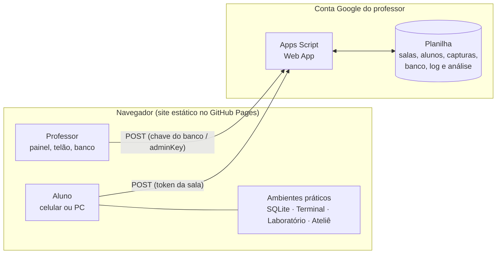

<div align="center">

# Trilha Rali

**Plataforma gamificada de aprendizagem para aulas de laboratório de informática.**
Competições em equipe com etiquetas NFC, desafios individuais no estilo CTF e ambientes práticos que rodam no próprio navegador.

[](https://ebersantana.github.io/TrilhaRali/)


**Instituto Federal de Sergipe (IFS) · Campus Tobias Barreto**
Desenvolvido e mantido pelo **Prof. Eber Santana**

[Acessar a plataforma](https://ebersantana.github.io/TrilhaRali/) · [Catálogo de missões](#catálogo-de-missões) · [Ambientes práticos](#ambientes-práticos) · [Instalação](#instalação-e-execução-local) · [Backend](#backend-google-apps-script)

</div>

---

## Sumário

1. [Visão geral](#visão-geral)
2. [Modos de jogo](#modos-de-jogo)
3. [Ambientes práticos](#ambientes-práticos)
4. [Catálogo de missões](#catálogo-de-missões)
5. [Ciclo de uma sala](#ciclo-de-uma-sala)
6. [Banco de perguntas do professor](#banco-de-perguntas-do-professor)
7. [Pontuação, cronômetro e temas](#pontuação-cronômetro-e-temas)
8. [Registro e análise no servidor](#registro-e-análise-no-servidor)
9. [Arquitetura](#arquitetura)
10. [Instalação e execução local](#instalação-e-execução-local)
11. [Publicação no GitHub Pages](#publicação-no-github-pages)
12. [Backend (Google Apps Script)](#backend-google-apps-script)
13. [Etiquetas NFC e QR code](#etiquetas-nfc-e-qr-code)
14. [Como adicionar um pacote de missões](#como-adicionar-um-pacote-de-missões)
15. [Segurança e privacidade](#segurança-e-privacidade)
16. [Testes](#testes)
17. [Estrutura do projeto](#estrutura-do-projeto)
18. [Solução de problemas](#solução-de-problemas)
19. [Créditos](#créditos)

---

## Visão geral

A **Trilha Rali** transforma uma aula de laboratório em uma competição organizada. O professor escolhe as perguntas, abre a sala, projeta o ranking e controla o tempo. Os alunos respondem pelo celular ou pelo computador, sem instalar nada.

A plataforma é um **site estático**. Não há servidor próprio para manter: os dados ficam em uma **planilha Google do próprio professor**, acessada por um **Google Apps Script** publicado como aplicativo da Web.

| Para o professor | Para o aluno |
|---|---|
| 281 missões prontas em 5 disciplinas, mais o banco de perguntas próprio | Entra com o token da sala ou tocando uma etiqueta NFC |
| Seletor de perguntas em árvore (Disciplina › Assunto › Pergunta) | Recebe retorno imediato de acerto ou erro |
| Telão com Top 5, cronômetro, alertas sonoros e pódio final | Vê tempo restante, XP e posição no ranking |
| Debriefing com gabarito comentado, liberado quando quiser | Resolve missões práticas em ambientes simulados no navegador |
| Histórico de salas, log de eventos e análise de acerto por pergunta | Funciona em qualquer celular moderno |

**Princípios do projeto**

- **Sem infraestrutura para manter.** Site estático no GitHub Pages; backend na conta Google do professor.
- **Correção no servidor.** No CTF, gabarito, avanço de fase e trava de tempo nunca dependem do navegador do aluno.
- **Prática antes da memorização.** Cada disciplina tem um ambiente onde a resposta é encontrada fazendo: executando SQL, comandos Linux, inspecionando arquivos ou editando HTML e CSS.
- **Gabaritos verificados por teste.** As respostas das missões práticas são recalculadas automaticamente a partir dos próprios ambientes.

---

## Modos de jogo

Os dois modos são independentes, compartilham o banco de perguntas e seguem o mesmo roteiro no painel do professor. Os endereços `#/rali`, `#/ctf` e `#/professor` abrem cada área diretamente.

### Rali NFC: em equipes

Dinâmica presencial. Etiquetas **NTAG213** (ou QR codes) espalhadas pelo laboratório guardam as missões. Cada equipe elege um **aluno scanner**, que encosta o celular na etiqueta, lê a pergunta, resolve com o grupo e envia a resposta.

- Sala com token criada pelo professor; a equipe entra com token, nome e integrantes.
- Leitura por NFC (Android/Chrome), QR code ou digitação do código da etiqueta.
- Aviso de etiqueta já resolvida, feed de respostas ao vivo e ranking no telão.

### CTF Online: individual

Cada aluno joga sozinho no navegador. O professor escolhe o formato ao criar a sala:

| Formato | Como funciona | Ranking |
|---|---|---|
| **Livre** | Painel de desafios; o aluno escolhe a ordem | Por pontos |
| **Em ordem** | Uma fase por vez; só avança quem resolve a fase atual | Por fase e pontos |

- O aluno só recebe as perguntas permitidas pelo servidor, com intervalo de 3 s após cada erro.
- Os **ambientes práticos** aparecem conforme as missões da sala (ver abaixo).

---

## Ambientes práticos

Os ambientes rodam inteiramente no navegador do aluno, sem acesso à rede ou ao computador da escola.

| Ambiente | Disciplina | Quando aparece | O que o aluno faz |
|---|---|---|---|
| **Console SQL** | Banco de Dados | Liberado pelo professor na sala | Executa SQL em um SQLite real (`sql.js`/WebAssembly) com as tabelas da escola e do laboratório |
| **Terminal Linux** | Fundamentos de Sistemas Operacionais | Liberado pelo professor na sala | Usa um shell simulado com sistema de arquivos, permissões e processos |
| **Laboratório de Informática** | Informática Básica | Automaticamente, se a sala tiver missões `info_*` | Investiga ficha do computador, pasta de arquivos, navegador, e-mail, nuvem, documento, planilha com fórmulas e apresentação |
| **Cruzadinha** | Todas (vocabulário da disciplina da sala) | Liberada pelo professor na sala, com limite de dicas e quantidade de palavras definidos por ele | Palavras cruzadas geradas no navegador (mesma grade para toda a sala), dicas de letra e de palavra que reduzem o XP, progresso salvo no aparelho; o XP das palavras soma no ranking da sala (o servidor confere as palavras contra o gabarito gravado pelo professor ; no modo CTF Dinâmico, quem fecha a palavra primeiro ganha o valor cheio e os seguintes perdem 10% por posição, até 40%) |
| **Ateliê Web** | Construção de Sites 1 | Automaticamente, se a sala tiver missões `web_*` | Inspeciona um site de exemplo, lê `index.html` e `estilo.css` e testa HTML/CSS em um editor com pré-visualização ao vivo |

**Destaques**

- **Planilha do Laboratório:** fórmulas em português (`SOMA`, `MEDIA`, `SE`, `CONT.SE`, `SOMASE`, `MAIOR`, `ARRED`…), classificação por coluna, filtro e barra de teste de fórmulas. O avaliador é próprio e não usa `eval`.
- **Inspecionar do Ateliê Web:** o aluno clica em um elemento e vê os estilos calculados pelo navegador (largura total, `box-sizing`, `padding`, cor, fonte…), como nas ferramentas de desenvolvedor.
- **Pré-visualização isolada:** o código do aluno roda em um `iframe` com `sandbox`, sem permissão para executar JavaScript.

---

## Catálogo de missões

Todas aparecem no seletor de perguntas da sala, organizadas por disciplina e assunto.

| Disciplina | Assuntos | Missões | Ambiente | Verificação automática |
|---|---|---:|---|---|
| Banco de Dados (Rali SQL) | 9 pacotes: DDL, JOINs, DML, transações, subconjuntos SQL… | 50 | Etiquetas NFC | Gabarito revisado |
| Banco de Dados | Fácil, Médio, Difícil (CRUD, cardinalidade, DDL/DML/DQL/DTL/DCL, INNER/LEFT/RIGHT/FULL OUTER JOIN) | 60 | Console SQL | Cada solução é executada no SQLite |
| Fundamentos de Sistemas Operacionais | Navegação, arquivos e texto, permissões, sistema e processos | 51 | Terminal Linux | Testes do shell simulado |
| Informática Básica | Fácil, Média, Difícil (hardware e software, Internet e e-mail, texto, planilha, slides) | 60 | Laboratório de Informática | Respostas recalculadas a partir dos arquivos |
| Construção de Sites 1 | Fácil, Média, Difícil (10 de HTML e 10 de CSS por nível) | 60 | Ateliê Web | Respostas recalculadas a partir do código do site |
| **Total** | | **281** | | |

Os pacotes de 60 missões seguem a mesma proporção: **20 fáceis (10 XP), 20 médias (20 XP) e 20 difíceis (30 XP)**. O repositório também traz 50 missões de console SQL usadas como base de testes (`consoleMissions.ts`), que não aparecem no seletor.

<details>
<summary><strong>Cobertura de Construção de Sites 1</strong> (Dicionário Técnico HTML &amp; CSS)</summary>

- **HTML:** listas, links e mídia, tabelas, formulários, estrutura semântica e atributos.
- **CSS:** formas de aplicar, seletores, cor e fundo, texto e fonte, modelo de caixa, exibição e posicionamento, Flexbox, efeitos, unidades e cores.
- As difíceis exigem experimentação: largura da caixa com e sem `box-sizing`, cascata e especificidade, conversão de `rem`/`em` para px.

</details>

<details>
<summary><strong>Cobertura de Informática Básica</strong> (ementa da disciplina)</summary>

Quatro missões por unidade em cada nível: hardware e software; Internet, e-mail e nuvem; editor de texto; editor de planilha; apresentação de slides.

</details>

---

## Ciclo de uma sala

O painel do professor (protegido por PIN) segue o mesmo roteiro nos dois modos.

```text
 1. Perguntas    Seletor em árvore: Disciplina › Assunto › Pergunta (marca em qualquer nível, busca, sorteio)
 2. Turma        Token da sala, link de convite, alunos ou equipes conectados
 3. Ao vivo      Telão com Top 5, cronômetro, pausa, +5 min e liberação do Console SQL / Terminal Linux
 4. Resultados   Ranking completo, envios e exportação
 5. Debriefing   Gabarito com explicações, liberado para alunos e equipes quando o professor quiser
```

Ao terminar, **Encerrar sala** congela o resultado e grava o resumo no servidor. **Nova sala** reinicia o roteiro, e o **histórico** guarda as salas encerradas (sincronizado com a planilha) para consulta posterior.

**Exemplo de aula de 100 minutos (Rali NFC)**

| Tempo | Fase | O que acontece |
|---|---|---|
| 00–15 min | Briefing | Divisão em equipes, projeção do telão, escolha do aluno scanner |
| 15–85 min | Sprint | Equipes leem as etiquetas, resolvem e enviam; o professor faz mentoria |
| 85–90 min | Encerramento | Respostas bloqueadas, pódio final |
| 90–100 min | Debriefing | Revisão das perguntas com maior taxa de erro |

A duração é configurável de 5 a 120 minutos.

---

## Banco de perguntas do professor

Além do catálogo, o professor mantém o próprio banco na aba `Banco` da planilha, em **Área do professor › Banco de perguntas**. A conexão usa uma **chave do banco**, pedida uma vez por aparelho.

| Tipo | Como o aluno responde | Correção |
|---|---|---|
| `exata` | Digita a resposta | Compara com o gabarito e as variações aceitas, ignorando acentos, maiúsculas, aspas e espaços extras |
| `multipla` | Escolhe entre 2 e 6 alternativas | A resposta correta deve estar entre as alternativas |

Cada pergunta guarda disciplina, assunto, tipo, enunciado, resposta, variações aceitas, alternativas, XP (1 a 100), explicação e situação (ativa ou inativa).

**Importação e exportação** em CSV (separador `;`, `,` ou tabulação) ou JSON. Listas usam `|`.

```csv
disciplina;assunto;tipo;pergunta;resposta;aceitas;opcoes;xp;explicacao
Redes de Computadores;Camada de rede;exata;Qual protocolo traduz nomes em endereços IP?;DNS;dns server;;10;
Segurança da Informação;Criptografia;multipla;Qual destes é um algoritmo simétrico?;AES;;RSA|AES|ECC;15;AES usa a mesma chave para cifrar e decifrar.
```

> **Atenção:** respostas que começam com `=` são interpretadas como fórmula pelo Google Sheets. Escreva `SOMA(A1:A5)` em vez de `=SOMA(A1:A5)`.

---

## Pontuação, cronômetro e temas

**Pontuação**

| Modo | Regra |
|---|---|
| **XP fixo** | Cada missão vale sempre o XP original |
| **Dinâmico (CTF)** | O valor cai 10% do XP base a cada nova captura da mesma pergunta, com piso de 40%. A primeira captura ganha o 🔥 |

**Cronômetro** (5 a 120 min, de 5 em 5)

- **CTF Online:** o tempo fica no servidor; respostas fora do tempo são recusadas e a sala trava ao zerar.
- **Rali NFC:** o telão espelha o relógio do servidor e os celulares o consultam periodicamente.
- Relógio âmbar nos últimos 5 minutos e vermelho no último, com aviso sonoro. O professor pode pausar, retomar e adicionar 5 minutos.

**Temas:** *Quadro claro* (padrão, para salas iluminadas) e *Arena escura* (para projetores de bom contraste). A escolha é salva no servidor e chega aos celulares dos alunos.

---

## Registro e análise no servidor

Desde o script **v11**, cada sala deixa um rastro completo na planilha:

| Aba | Conteúdo | Uso |
|---|---|---|
| `CtfLog` | Eventos com data e hora: criação, entradas, envios, mudanças de situação | Auditoria e acompanhamento da aula |
| `CtfResumo` | Uma linha por sala encerrada: duração, participantes, acertos, erros, taxa de acerto, XP médio | Comparar turmas e aulas |
| `CtfAnalise` | Uma linha por pergunta: acertos, participantes e taxa de acerto | Identificar conteúdos que precisam de revisão |

O resumo e a análise são gravados ao **encerrar a sala**. Os textos enviados pelos alunos são gravados com proteção contra injeção de fórmulas na planilha.

---

## Arquitetura



| Camada | Tecnologia |
|---|---|
| Interface | React 19, TypeScript, Tailwind CSS 4, Lucide |
| Build | Vite 8 |
| Banco no navegador | `sql.js` (SQLite compilado para WebAssembly) |
| NFC e QR | Web NFC (Android/Chrome), links por etiqueta, `qrcode` |
| Efeitos | `canvas-confetti` |
| Backend | Google Apps Script (Web App) com planilha Google |
| Hospedagem | GitHub Pages, publicado por GitHub Actions |

**Decisões de projeto**

- **Roteamento por hash** (`#/rali`, `#/ctf`, `#/professor`, `#/tag/<id>`): funciona em hospedagem estática e em links gravados em etiquetas.
- **Uma só lógica de tempo** (`src/utils/timer.ts`) para fases, alertas e formatação, com compensação da diferença de relógio entre aparelho e servidor.
- **Componentes compartilhados** (`src/components/common`): relógio, controle de tempo, cabeçalhos, avisos e pódio são os mesmos nos dois modos.
- **Mesma normalização de respostas** no app e no servidor: minúsculas, sem acentos, sem aspas nas pontas, sem `;` final e espaços colapsados.

---

## Instalação e execução local

Requisitos: **Node.js 20 ou superior** e npm.

```bash
git clone https://github.com/EberSantana/TrilhaRali.git
cd TrilhaRali
npm install --legacy-peer-deps
npm run dev        # http://localhost:3000
```

| Comando | O que faz |
|---|---|
| `npm run dev` | Servidor de desenvolvimento na porta 3000 |
| `npm run build` | Versão de produção em `dist/` |
| `npm run preview` | Serve a versão de produção localmente |
| `npm run lint` | Verificação de tipos (`tsc --noEmit`) |
| `npx tsx --test src/*/*.test.ts` | Suíte de testes completa |

---

## Publicação no GitHub Pages

O fluxo `.github/workflows/deploy.yml` compila e publica o site a cada `push` na branch `main` (e também pode ser disparado manualmente).

1. Em **Settings › Pages › Build and deployment › Source**, escolha **GitHub Actions**.
2. Envie as alterações para `main`.
3. Em cerca de um minuto o site estará em `https://<usuário>.github.io/<repositório>/`.

O `vite.config.ts` usa `base: './'`, então o site funciona com qualquer nome de repositório.

---

## Backend (Google Apps Script)

Um único script atende salas de CTF e NFC, banco de perguntas, cronômetro, tema, debriefing, log e análise. O código-fonte está em `src/data/ctfAppsScript.ts` e pode ser copiado pelo painel do professor (*Copiar script do servidor*). **Versão atual: v16.**

### Configuração inicial

1. Crie uma **planilha Google** nova e abra **Extensões › Apps Script**.
2. Apague o conteúdo, cole o script e salve.
3. Execute `setupBanco()` uma vez e **guarde a chave exibida**. O servidor armazena apenas o hash.
4. **Implantar › Nova implantação › Aplicativo da Web**, com *Executar como: Eu* e *Quem pode acessar: Qualquer pessoa*.
5. Copie a URL terminada em `/exec` e cole no painel do professor.
6. Para que os alunos digitem só o token, coloque a mesma URL em `DEFAULT_CTF_API_URL` (`src/config.ts`) e publique o site.

### Atualização do script

Cole o código novo e use **Implantar › Gerenciar implantações › Editar › Versão: Nova versão › Implantar**. Assim a URL `/exec` não muda. Para conferir a versão em produção, abra a URL `/exec` no navegador: a resposta informa `versao`.

### Histórico de versões

| Versão | Principais mudanças |
|---|---|
| **v16** | Cruzadinha: grade de até 25 palavras (banco com 32 por disciplina); no modo CTF Dinâmico quem fecha a palavra primeiro ganha mais (aba `CtfCruzCapturas`) |
| v15 | O servidor confere a Cruzadinha: o professor grava o gabarito (palavras da grade) ao liberar; o aluno envia as palavras resolvidas e o nível de ajuda; o XP é recalculado no servidor (coluna `cruzadinha_gabarito`) |
| v14 | Professor define quantas palavras tem a grade da Cruzadinha (6 a 16; coluna `cruzadinha_palavras`) |
| v13 | Ação `cruzSubmit`: XP da Cruzadinha entra no ranking (coluna `xp_cruz` em `CtfAlunos`; soma só a diferença; teto de 1500) |
| v12 | Cruzadinha liberada pelo professor, com limite de dicas por aluno (`setCruzadinha`, coluna `cruzadinha_dicas`) |
| v11 | Abas `CtfLog`, `CtfResumo` e `CtfAnalise`; resumo gravado ao encerrar; histórico de salas (`salasList`); proteção contra injeção de fórmulas |
| v10 | Passo 5 *Debriefing* nas salas de CTF e NFC |
| v9 | Nome repetido só entra pelo aparelho original; mensagens com acento; publicação NFC aceita tags `linux_NN` |
| v8 | Liberação do Terminal Linux pela sala |
| v7 | CTF em formato *livre* ou *em ordem* |
| v6 | Salas com token também no Rali NFC; pódio final nos dois modos |

Salas criadas em versões anteriores continuam funcionando.

### Abas criadas automaticamente

| Aba | Conteúdo |
|---|---|
| `CtfSalas` | Salas: token, tipo, situação, formato, pontuação, cronômetro, liberações e data de encerramento |
| `CtfMissoes` | Perguntas de cada sala |
| `CtfAlunos` | Progresso, XP, acertos, erros e 🔥 de cada aluno ou equipe |
| `CtfCapturas` | Cada captura: posição, XP e horário |
| `CtfLog`, `CtfResumo`, `CtfAnalise` | Registro e análise (v11) |
| `Banco` | Banco de perguntas do professor |
| `NfcPublicadas` | Conjunto publicado para o Rali NFC |

### API

Requisições `POST` com corpo `text/plain` contendo JSON; `GET` responde a verificação de versão.

| Grupo | Ações |
|---|---|
| Salas | `createRoom`, `join`, `state`, `submit`, `teacherRoom`, `setStatus`, `setBanco`, `setTerminal`, `setTimer`, `salasList` |
| Debriefing | `setDebriefing`, `debriefTeacher`, `debriefStudent` |
| Rali NFC | `raliTag`, `raliSubmit`, `raliTimer`, `raliEstado`, `nfcPublish`, `nfcSet` |
| Banco de perguntas | `bancoPing`, `bancoList`, `bancoSave`, `bancoDelete`, `bancoImport` |
| Geral | `ping`, `setTema` |

---

## Etiquetas NFC e QR code

Grave as etiquetas com o aplicativo gratuito **NFC Tools** (Android ou iOS):

1. Abra o NFC Tools e toque em **Escrever**.
2. **Adicionar um registro › URL** e cole o link da etiqueta, por exemplo `https://ebersantana.github.io/TrilhaRali/#/tag/tag_07`.
3. Toque em **Escrever** e encoste o celular na etiqueta **NTAG213**.

No painel do Rali NFC, o professor escolhe a quantidade de etiquetas, copia a lista de links, baixa o CSV e imprime etiquetas com QR code de reserva (sem pergunta nem resposta impressas).

---

## Como adicionar um pacote de missões

O mesmo padrão foi usado em Banco de Dados, Informática Básica e Construção de Sites 1.

1. **Dados:** crie `src/data/<pacote>Missions.ts` exportando um `Mission[]` com `id` e `tag_id` únicos, `package`, `packageName` (vira o assunto no seletor), `category`, `pergunta`, `resposta_curta`, `alternatives`, `xp_valor`, `explanation` e, se for múltipla escolha, `opcoes`.
2. **Tipos:** inclua os novos valores de `package` (e de `category`, se necessário) em `src/types/index.ts`.
3. **Catálogo:** adicione o array em `BASE` e `EXTRAS` de `src/utils/missionsStore.ts`.
4. **Disciplina:** mapeie o prefixo do pacote para o nome da disciplina em `catalogAsBank` (`src/components/rooms/RoomsPanel.tsx`).
5. **Ambiente (opcional):** crie o componente em `src/components/ctf/` e exiba-o em `CtfStudent.tsx` quando a sala tiver tags com o prefixo do pacote.
6. **Testes:** crie `src/data/<pacote>Missions.test.ts` verificando contagens, unicidade de ids e tags, e recalculando cada gabarito a partir do ambiente.

---

## Segurança e privacidade

- **Correção no servidor (CTF):** gabarito, avanço de fase e trava de tempo são decididos pelo Apps Script.
- **Chave do banco:** verificada no servidor (hash SHA-256 nas propriedades do script); chaves erradas são recusadas.
- **Chave de administração por sala (`adminKey`):** exigida para alterar situação, tempo, liberações e debriefing.
- **PIN do professor:** protege apenas a interface no aparelho; a proteção dos dados está nas chaves verificadas no servidor.
- **Rali NFC:** a resposta das missões padrão é conferida no celular. Para avaliações com nota, prefira o CTF Online com perguntas inéditas do seu banco, já que o catálogo embutido é público.
- **Planilha protegida:** textos enviados pelos alunos são gravados sem risco de virarem fórmulas.
- **Ambientes isolados:** SQL, terminal, laboratório e Ateliê Web rodam no navegador; a pré-visualização HTML usa `iframe` com `sandbox`, sem execução de scripts.
- **Dados pessoais (LGPD):** são guardados apenas o nome informado pelo aluno e seu desempenho, na planilha do próprio professor. Não há cadastro, e-mail nem rastreamento.
- Nunca publique a chave do banco, a `adminKey` ou arquivos `.env` no repositório.

---

## Testes

```bash
npx tsx --test src/*/*.test.ts
```

**104 testes**, organizados em:

| Área | O que é verificado |
|---|---|
| Backend | O código do Apps Script roda contra uma planilha simulada: salas, entrada, envio, trava de tempo, banco, publicação, tema, debriefing, log e resumo |
| Missões de Banco de Dados | Cada solução é executada no SQLite e precisa reproduzir o gabarito |
| Missões de Informática Básica | Gabaritos recalculados a partir dos arquivos do Laboratório; avaliador de fórmulas da planilha |
| Missões de Construção de Sites 1 | Gabaritos recalculados a partir do HTML e CSS do site; montagem da pré-visualização |
| Terminal Linux | Comandos, sistema de arquivos e permissões do shell simulado |
| Catálogo | Unicidade de ids e tags em todos os pacotes; modo "só meu banco" |
| Cronômetro, ranking e pontuação | Limites, fases, alertas, posições, subidas e descidas, XP dinâmico |
| Banco de perguntas | Validação, importação CSV/JSON, filtros e sorteio |

---

## Estrutura do projeto

```text
TrilhaRali/
├── .github/workflows/deploy.yml   Publicação no GitHub Pages
├── public/                        Arquivos estáticos
├── src/
│   ├── App.tsx                    Roteamento por hash e estado do Rali
│   ├── config.ts                  URL padrão do backend (DEFAULT_CTF_API_URL)
│   ├── components/
│   │   ├── TeacherHub.tsx         Área do professor
│   │   ├── ClassroomProjector.tsx Telão do Rali NFC
│   │   ├── StudentScanner.tsx     Tela da equipe no Rali NFC
│   │   ├── rooms/                 Salas: seletor de perguntas, telão, resultados, debriefing
│   │   ├── ctf/                   CTF: aluno, desafios, Top 5 e ambientes práticos
│   │   │   ├── SqlConsole.tsx         Console SQL
│   │   │   ├── LinuxTerminal.tsx      Terminal Linux
│   │   │   ├── LabInformatica.tsx     Laboratório de Informática
│   │   │   ├── AtelieWeb.tsx          Ateliê Web
│   │   │   └── Cruzadinha.tsx         Cruzadinha (palavras cruzadas)
│   │   ├── bank/                  Banco de perguntas e importação
│   │   └── common/                Relógio, cabeçalhos, avisos, pódio e temas
│   ├── data/
│   │   ├── missions.ts            50 missões do Rali SQL (NFC)
│   │   ├── bdMissions.ts          60 missões de Banco de Dados
│   │   ├── linuxMissions.ts       51 missões de Linux
│   │   ├── infoMissions.ts        60 missões de Informática Básica
│   │   ├── infoLab.ts             Arquivos do Laboratório de Informática
│   │   ├── webMissions.ts         60 missões de Construção de Sites 1
│   │   ├── webLab.ts              Site de exemplo do Ateliê Web
│   │   ├── consoleMissions.ts     Missões de console usadas nos testes
│   │   └── ctfAppsScript.ts       Código do backend (Apps Script v16)
│   ├── utils/                     Tempo, tema, banco, ranking, API, SQLite, shell e planilha
│   └── types/                     Tipos compartilhados
├── index.html
├── vite.config.ts
└── package.json
```

---

## Solução de problemas

| Sintoma | Causa provável e solução |
|---|---|
| O site mostra a versão antiga | Recarregue sem cache: **Ctrl+Shift+R** (**Cmd+Shift+R** no Mac) |
| "Chave do banco inválida" | Chave digitada errada ou script recriado. Conecte de novo em *Banco de perguntas* |
| O aluno não consegue entrar | Confira o token e a URL do backend (`DEFAULT_CTF_API_URL` ou link de convite) |
| Uma função nova não funciona | O script na planilha está desatualizado. Publique a **nova versão** e confira `versao` na URL `/exec` |
| O seletor não mostra minhas perguntas | Por padrão aparecem só as **ativas**: marque *Incluir perguntas inativas* ou ative-as no banco |
| O Laboratório ou o Ateliê Web não aparece | Eles surgem só quando a sala contém missões `info_*` ou `web_*` |
| O relógio não aparece no celular (Rali NFC) | O aparelho do professor precisa estar com o banco conectado |
| "Tempo limite do bloqueio" | Muitas gravações simultâneas na planilha; repita a operação |
| O NFC não lê a etiqueta | Web NFC exige Android com Chrome; no iPhone, use o link ou o QR code |
| Resposta com `=` virou erro na planilha | O Sheets trata `=` como fórmula; escreva a resposta sem o sinal |

---

## Créditos

**Instituto Federal de Sergipe (IFS) · Campus Tobias Barreto**
Concepção, desenvolvimento e supervisão pedagógica: **Prof. Eber Santana** ([@prof.ebersantana](https://instagram.com/prof.ebersantana)).

Sugestões e melhorias são bem-vindas por *issues* e *pull requests*.

<div align="center">

**Trilha Rali** · IFS Campus Tobias Barreto · 2026

</div>
