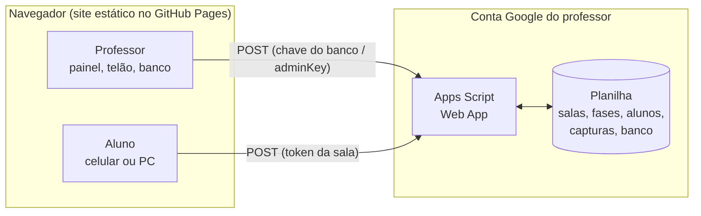

<div align="center">

# 🏁 Trilha Rali

**Plataforma gamificada de aprendizagem para o laboratório de informática:**
**Rali NFC em equipes, CTF Online individual e banco de perguntas do professor.**

[](https://ebersantana.github.io/TrilhaRali/)


**Instituto Federal de Sergipe (IFS) · Campus Tobias Barreto**
Desenvolvido e supervisionado pelo **Prof. Eber Santana**

[Acessar o site](https://ebersantana.github.io/TrilhaRali/) · [Módulos](#-os-módulos) · [Instalação](#-instalação-e-execução-local) · [Backend](#-backend-google-apps-script) · [Banco de perguntas](#-banco-de-perguntas)

</div>

---

## 📑 Sumário

1. [Visão geral](#-visão-geral)
2. [Os módulos](#-os-módulos)
3. [Fluxo da aula](#-fluxo-da-aula)
4. [Funcionalidades](#-funcionalidades)
5. [Banco de perguntas](#-banco-de-perguntas)
6. [Pontuação](#-pontuação)
7. [Cronômetro e temas](#-cronômetro-compartilhado-e-temas)
8. [Arquitetura](#-arquitetura)
9. [Instalação e execução local](#-instalação-e-execução-local)
10. [Publicação no GitHub Pages](#-publicação-no-github-pages)
11. [Backend (Google Apps Script)](#-backend-google-apps-script)
12. [Etiquetas NFC](#-etiquetas-nfc-e-qr-code)
13. [Segurança e privacidade](#-segurança-e-privacidade)
14. [Testes](#-testes)
15. [Estrutura do projeto](#-estrutura-do-projeto)
16. [Solução de problemas](#-solução-de-problemas)
17. [Créditos](#-créditos)

---

## 🎯 Visão geral

A **Trilha Rali** transforma uma aula de laboratório em uma competição organizada. O professor escolhe as perguntas, abre a sala, projeta o ranking e acompanha o tempo; os alunos respondem pelo celular ou pelo navegador. Tudo roda como um site estático, sem servidor próprio: a persistência fica em uma **planilha Google** do próprio professor, acessada por um **Google Apps Script**.

| Para o professor | Para o aluno |
|---|---|
| Banco de perguntas por disciplina, com importação CSV/JSON | Entra com um token de sala ou toca uma etiqueta NFC |
| Cronômetro de 5 a 120 minutos, que bloqueia as respostas ao zerar | Vê o tempo restante, o XP e a posição no ranking |
| Telão com Top 5, cronômetro e pódio final | Recebe retorno imediato de acerto ou erro |
| Dois temas visuais (escuro e claro) escolhidos em um clique | Funciona em qualquer celular, sem instalar aplicativo |

> O sistema nasceu para o **Rali de Banco de Dados** (SQL), e hoje serve a qualquer disciplina: o banco de perguntas atual cobre 11 disciplinas.

---

## 🧩 Os módulos

O topo do site alterna entre os módulos. Os endereços `#/rali`, `#/ctf` e `#/professor` abrem cada um direto.

> **Novo (script v9):** nome repetido na sala só entra pelo aparelho original, mensagens do servidor com acento e publicação NFC aceita tags `linux_NN`. Cole o script v9 e publique uma **nova versão**.
> **Novo (script v10):** passo 5 "Debriefing" nas salas de CTF e NFC: o professor vê o gabarito com explicações e libera para alunos/equipes. Cole o script v10 e publique uma **nova versão**.

> **Script v8:** o professor pode liberar um **Terminal Linux simulado** (botão "Terminal Linux" na sala, igual ao Console SQL). Cole o script v8 e publique uma **nova versão**.

> **Novidade (script v7):** o **CTF Online** agora pode ser **livre** (painel de desafios: o aluno escolhe a ordem e o ranking é por pontos) ou **em ordem** (fase a fase), escolhido na criação de cada sala. Cole o script v7 no Apps Script e publique uma **nova versão**; salas antigas continuam em ordem.
>
> **Script v6:** o Rali NFC agora também tem **salas com token criadas pelo professor**, como o CTF Online. Os dois ambientes são independentes (painel `#/professor/rali` e `#/professor/ctf`) e só **compartilham o banco de perguntas**. A equipe entra com token + nome da equipe, lê as etiquetas NFC/QR (ou digita o código) e vê o ranking; ao fim do tempo, ou quando o professor encerra a sala, aparece o **pódio final** nos dois ambientes e nos dois temas. O tema claro é o padrão e a logo tem versão própria para fundo branco. Ao atualizar, cole o script v6 no Apps Script e publique uma **nova versão**.

### 🏷️ Rali NFC — em equipes

Dinâmica presencial. Etiquetas **NTAG213** (ou QR codes) espalhadas pelo laboratório guardam as missões. Cada equipe elege um **aluno scanner** que encosta o celular na etiqueta, lê a pergunta, resolve com o grupo e envia a resposta. O ranking atualiza no **Telão**.

- 50 missões padrão em 9 pacotes de SQL, ou o seu conjunto de perguntas publicado a partir do banco.
- Salas e equipes com nome dos integrantes e scanner oficial.
- Aviso de **tag repetida** (a equipe já resolveu aquela missão) e feed ao vivo de respostas.
- **Debriefing** ao final, com os desafios de maior taxa de erro.

### 🚩 CTF Online — individual

Cada aluno joga sozinho no navegador. **Uma pergunta por fase, em ordem fixa: só avança quem resolve a fase atual.**

- O professor cria uma **sala** e recebe um **token**; os alunos entram com o token e o nome.
- A validação e o avanço de fase acontecem **no servidor**. O aluno só recebe a pergunta da fase atual, com intervalo de 3 s após cada erro.
- **Console SQLite no navegador** (via `sql.js`) para as missões práticas; o professor libera ou oculta o banco e o console quando quiser.
- 50 missões que só se resolvem executando comandos no console (consultas, agregações, JOINs, subconsultas, DDL e integridade).

### 👩‍🏫 Painel do professor

Central de administração protegida por PIN, organizada em um roteiro igual para os dois módulos: **Perguntas → Turma → Ao vivo → Resultados**.

---

## 🧭 Fluxo da aula

```text
1. Conteúdo      Banco de perguntas ──► escolhe disciplina/assunto ──► sorteia ou marca
                                          │
                       ┌──────────────────┴──────────────────┐
                       ▼                                       ▼
2. Aula         Rali NFC (equipes)                     CTF Online (individual)
                 Perguntas   Missões e gabarito          Perguntas   Escolher fases
                 Turma       Salas e equipes             Turma       Salas e tokens
                 Ao vivo     Telão e cronômetro          Ao vivo     Telão e cronômetro
                 Resultados  Debriefing                  Resultados  Ranking e envios
```

Exemplo de aula de 100 minutos com o Rali NFC:

| Tempo | Fase | O que acontece |
|---|---|---|
| 00–15 min | **Briefing** | Divisão em equipes, projeção do telão, escolha do aluno scanner |
| 15–85 min | **Sprint** | Alunos escaneiam as tags, resolvem e enviam; o professor circula dando mentoria |
| 85–90 min | **Hard stop** | Respostas bloqueadas, revelação do pódio e bônus |
| 90–100 min | **Debriefing** | Revisão dos desafios com mais erros |

A duração é configurável (5 a 120 min); o roteiro acima é apenas uma sugestão.

---

## ✨ Funcionalidades

- **Dois modos de jogo** com a mesma identidade visual, o mesmo relógio, o mesmo Top 5 e os mesmos avisos de estado.
- **Seletor único de perguntas** nos dois módulos: filtro por disciplina e assunto, busca, perguntas inativas opcionais e sorteio de N perguntas.
- **Telão** com Top 5 em pódio (tema escuro) ou barras (tema claro), setas de subida e descida (▲ ▼), "+XP" em destaque e **pódio final com confete** quando o tempo acaba.
- **Alertas de tempo**: o relógio fica âmbar nos últimos 5 minutos e vermelho no último; o telão e o painel tocam um aviso sonoro.
- **Tempo extra e pausa**: `+5 min` reabre a sala depois de zerar; o professor pausa e retoma quando quiser.
- **Posição no celular**: o aluno do CTF vê "2º de 30" e o aluno do NFC vê a posição da equipe.
- **Link de tag**: `…/#/tag/tag_07` abre o app já na missão; o mesmo link vira QR code de reserva.
- **Etiquetas imprimíveis** (QR + código + categoria + XP, sem pergunta nem resposta) e exportação em CSV.
- **Exportação para Google Sheets** com cada captura registrada (posição, XP e 🔥).

---

## 📚 Banco de perguntas

As perguntas ficam na sua planilha Google (aba `Banco`), gerenciadas em **Área do professor › Banco de perguntas**. A conexão usa uma **chave do banco** pedida uma vez por aparelho.

**Dois tipos de pergunta**

| Tipo | Como o aluno responde | Correção |
|---|---|---|
| `exata` | Digita a resposta | Compara com o gabarito e as variações aceitas, ignorando acentos, maiúsculas e espaços extras |
| `multipla` | Escolhe entre 2 e 6 alternativas | A resposta correta deve ser uma das alternativas |

**O que cada pergunta guarda:** disciplina, assunto, tipo, enunciado, resposta, variações aceitas, alternativas, XP (1 a 100), explicação e situação (ativa ou inativa).

**Usar a mesma seleção nos dois módulos:** marque perguntas no banco e use os botões **Rali NFC** ou **CTF Online**. No CTF, a criação de sala também traz o mesmo seletor, com a opção *Incluir perguntas inativas*.

**Importar e exportar:** aceita CSV (separador `;`, `,` ou tabulação) e JSON.

```csv
disciplina;assunto;tipo;pergunta;resposta;aceitas;opcoes;xp;explicacao
Redes de Computadores;Camada de rede;exata;Qual protocolo traduz nomes em endereços IP?;DNS;dns server;;10;
Segurança da Informação;Criptografia;multipla;Qual destes é um algoritmo simétrico?;AES;;RSA|AES|ECC;15;AES usa a mesma chave para cifrar e decifrar.
```

Listas (`aceitas`, `opcoes`) usam `|` como separador.

> ⚠️ **Respostas que começam com `=`** são interpretadas como fórmula pelo Google Sheets. Escreva "SOMA(A1:A5)" em vez de "=SOMA(A1:A5)" e deixe claro no enunciado.

---

## 🔥 Pontuação

O professor escolhe o modo no telão do Rali ou ao criar a sala do CTF:

| Modo | Regra |
|---|---|
| **XP fixo** (Rali Tradicional) | Cada missão sempre vale o XP original |
| **CTF Dinâmico** | O valor cai conforme mais pessoas capturam a mesma flag: perde 10% do XP base por posição (10, 9, 8, 7…), com piso de 40%. Quem captura primeiro ganha o 🔥 |

Antes de enviar, o aluno vê o valor atual da flag ("🔥 FLAG INTACTA!" ou "⚠️ 2 alunos já resolveram: vale 8 XP").

---

## ⏲️ Cronômetro compartilhado e temas

**Cronômetro (5 a 120 min, de 5 em 5)** nos dois módulos:

- **CTF Online:** o tempo fica no servidor, por sala. As respostas só valem com o relógio rodando e a sala trava sozinha ao zerar.
- **Rali NFC:** o telão do professor espelha o relógio no servidor e os celulares dos alunos o leem a cada 30 s (exige a chave do banco no aparelho do professor).

**Temas** (em *Área do professor › Aparência*):

| Tema | Indicado para |
|---|---|
| **Arena escura** | Salas com pouca luz e projetores de bom contraste |
| **Quadro claro** | Salas iluminadas ou projetores fracos |

Com o banco conectado, a escolha é salva no servidor e chega aos celulares dos alunos.

---

## 🏗️ Arquitetura



| Camada | Tecnologia |
|---|---|
| Interface | React 19, TypeScript, Tailwind CSS 4, Lucide |
| Build | Vite 8 |
| Console SQL no navegador | `sql.js` (SQLite compilado para WebAssembly) |
| NFC | Web NFC (Android/Chrome) e links por etiqueta (Android e iPhone) |
| QR code e confete | `qrcode`, `canvas-confetti` |
| Backend | Google Apps Script publicado como Web App, com planilha Google como banco |
| Hospedagem | GitHub Pages, publicado por GitHub Actions |

**Decisões de projeto**

- **Sem servidor para manter.** O site é estático e o backend roda na conta Google do professor.
- **Validação no servidor.** No CTF, as respostas e o avanço de fase nunca dependem do navegador do aluno.
- **Mesma lógica de tempo em todos os lugares.** Um único conjunto de funções (`src/utils/timer.ts`) calcula fases, alertas e formatação, com compensação da diferença de relógio entre o aparelho e o servidor.
- **Componentes compartilhados** (`src/components/common`): relógio, controle de tempo, cabeçalho de telão, cabeçalho de aluno e avisos de estado são os mesmos nos dois módulos.

---

## 💻 Instalação e execução local

Requisitos: **Node.js 20 ou superior** e npm.

```bash
git clone https://github.com/EberSantana/TrilhaRali.git
cd TrilhaRali
npm install --legacy-peer-deps
npm run dev        # http://localhost:3000
```

| Comando | O que faz |
|---|---|
| `npm run dev` | Servidor de desenvolvimento na porta 3000 |
| `npm run build` | Gera a versão de produção em `dist/` |
| `npm run preview` | Serve a versão de produção localmente |
| `npm run lint` | Verificação de tipos (`tsc --noEmit`) |
| `npx tsx --test src/*/*.test.ts` | Roda toda a suíte de testes |

---

## 🚀 Publicação no GitHub Pages

O repositório já traz o fluxo `.github/workflows/deploy.yml`, que compila e publica a cada `push` na branch `main`.

1. Em **Settings › Pages › Build and deployment › Source**, escolha **GitHub Actions**.
2. Faça `git push origin main`.
3. Em cerca de um minuto o site estará em **`https://<usuário>.github.io/<repositório>/`**.

O `vite.config.ts` usa `base: './'`, então o site funciona em qualquer nome de repositório sem ajuste.

---

## 🔌 Backend (Google Apps Script)

Um único script atende o CTF, o banco de perguntas, o cronômetro e o tema. O código está em `src/data/ctfAppsScript.ts` e também pode ser copiado pelo painel do professor (botão *Copiar script do servidor*).

**Configuração (uma vez)**

1. Crie uma **planilha Google nova** e abra **Extensões › Apps Script**.
2. Apague o conteúdo, cole o script e salve.
3. Execute a função `setupBanco()` uma vez e **guarde a chave** exibida: é a chave do banco de perguntas (no servidor fica só o hash).
4. **Implantar › Nova implantação › Aplicativo da Web**, com *Executar como: Eu* e *Acesso: Qualquer pessoa*.
5. Copie a URL terminada em `/exec` e cole no painel do professor.
6. Para os alunos digitarem só o token, coloque a mesma URL em `DEFAULT_CTF_API_URL` (`src/config.ts`) e publique o site.

**Depois de atualizar o código do script:** cole o novo código e use **Implantar › Gerenciar implantações › Editar › Nova versão**. A URL não muda.

**Abas criadas automaticamente na planilha**

| Aba | Conteúdo |
|---|---|
| `CtfSalas` | Salas, token, situação, modo de pontuação e cronômetro |
| `CtfMissoes` | Fases de cada sala |
| `CtfAlunos` | Progresso, XP, acertos, erros e 🔥 de cada aluno |
| `CtfCapturas` | Registro de cada captura (posição, XP, horário) |
| `Banco` | Banco de perguntas do professor |
| `NfcPublicadas` | Conjunto publicado para o Rali NFC |

**Ações da API** (POST com corpo `text/plain` contendo JSON): `createRoom`, `join`, `state`, `submit`, `teacherRoom`, `setStatus`, `setBanco`, `setTimer`, `raliTimer`, `raliEstado`, `setTema`, `bancoPing`, `bancoList`, `bancoSave`, `bancoDelete`, `bancoImport`, `nfcPublish`, `nfcSet`.

---

## 🏷️ Etiquetas NFC e QR code

Use o aplicativo gratuito **NFC Tools** (Android ou iOS):

1. Abra o **NFC Tools** e toque em **Escrever**.
2. **Adicionar um registro › URL** e cole o link da tag (ex.: `https://ebersantana.github.io/TrilhaRali/#/tag/tag_07`).
3. Toque em **Escrever** e encoste o celular na etiqueta **NTAG213**.

Em **Rali NFC › 50 Missões › Etiquetas NFC/QR**, o professor escolhe a quantidade de tags, copia a lista de links, baixa o CSV e imprime as etiquetas com QR code de reserva.

**Missões padrão (50 em 9 pacotes)**

| Pacote | Tags | Conteúdo |
|---|---|---|
| MVP Base | `tag_01`–`tag_05` | DDL, COUNT, JOIN, WHERE no UPDATE, subconsulta |
| Academia | `tag_acad_01`–`06` | Cardinalidade, FK, tipagem, N:N |
| 16 CRUD | `tag_crud_01`–`05` | INSERT/NULL, GROUP BY, ORDER BY, DELETE sem WHERE |
| Biblioteca | `tag_bib_01`–`05` | Chave primária, integridade referencial, INNER e LEFT JOIN |
| Supermercado | `tag_sup_01`–`05` | Verdadeiro/falso sobre JOIN, IS NULL, CROSS JOIN |
| Fechamento | `tag_extra_01`–`04` | COMMIT, ROLLBACK, GRANT |
| Rali dos JOINs | `tag_join_01`–`06` | INNER, LEFT, RIGHT, FULL e CROSS JOIN |
| Mutação DML | `tag_dml_01`–`05` | SET, UPDATE e DELETE |
| Subconjuntos SQL | `tag_img_01`–`09` | DDL, DML, DCL, TCL, TRUNCATE, SAVEPOINT, MERGE |

O banco SQLite do laboratório (`banco_rali.sql`) é baixado com um clique na aba **SQLite** e traz as tabelas `equipes`, `missoes`, `Funcionarios`, `Produtos`, `Vendas`, `Alunos`, `bens`, `Livros`, `Emprestimos` e `Plano`.

---

## 🔒 Segurança e privacidade

- **CTF:** a correção e o avanço de fase ocorrem no servidor; o aluno só recebe a pergunta da fase atual.
- **Banco de perguntas:** protegido por uma chave verificada no servidor (hash SHA-256 nas propriedades do script). Uma chave errada é recusada.
- **PIN do professor:** protege a **interface** do painel neste aparelho. A proteção real dos dados está na chave do banco e na `adminKey` de cada sala, ambas verificadas no servidor.
- **Rali NFC:** a resposta é conferida **no celular**, como nas missões padrão. Para provas ou notas, prefira o CTF Online.
- **Banco de questões padrão:** as 100 missões embutidas estão no código-fonte público. Para avaliações com nota, use perguntas inéditas do seu banco.
- **Dados pessoais:** o sistema guarda apenas os nomes informados pelos alunos e seu desempenho, na planilha do próprio professor. Não há cadastro, e-mail nem rastreamento.
- Nunca publique a chave do banco, a `adminKey` ou arquivos `.env` no repositório.

---

## 🧪 Testes

```bash
npx tsx --test src/*/*.test.ts
```

A suíte (61 testes) cobre:

- **Backend simulado:** o código do Apps Script é executado em um ambiente de teste com planilha falsa, cobrindo salas, entrada de alunos, envio, trava de tempo, banco, publicação e tema.
- **Missões:** a solução de cada uma das 50 missões do console é executada no banco entregue aos alunos.
- **Cronômetro:** limites de 5 a 120 min, fases, alertas e formatação.
- **Banco de perguntas:** validação, importação CSV/JSON, filtros e sorteio.
- **Ranking:** posições, subidas, descidas e ganhos de XP.

---

## 🗂️ Estrutura do projeto

```text
TrilhaRali/
├── .github/workflows/deploy.yml     Publicação no GitHub Pages
├── public/                          Arquivos estáticos
├── src/
│   ├── App.tsx                      Roteamento entre módulos e estado do Rali
│   ├── config.ts                    URL padrão do backend (DEFAULT_CTF_API_URL)
│   ├── components/
│   │   ├── HomeLanding.tsx          Entrada do site
│   │   ├── TeacherHub.tsx           Painel do professor
│   │   ├── ClassroomProjector.tsx   Telão do Rali NFC
│   │   ├── StudentScanner.tsx       Tela do aluno no Rali NFC
│   │   ├── ctf/                     CTF: sala, aluno, telão, console SQL, Top 5
│   │   ├── bank/                    Banco de perguntas, seletor, importação
│   │   └── common/                  Relógio, cabeçalhos, avisos e temas compartilhados
│   ├── data/
│   │   ├── missions.ts              50 missões padrão do Rali
│   │   ├── consoleMissions.ts       50 missões do console SQLite
│   │   └── ctfAppsScript.ts         Código do backend (Apps Script)
│   ├── utils/                       Cronômetro, tema, banco, ranking, API e armazenamento
│   └── types/                       Tipos compartilhados
├── index.html
├── vite.config.ts
└── package.json
```

---

## 🛠️ Solução de problemas

| Sintoma | Causa provável e solução |
|---|---|
| O site mostra a versão antiga | Recarregue sem cache: **Ctrl+Shift+R** (**Cmd+Shift+R** no Mac) |
| "Chave do banco invalida" | A chave foi digitada errada ou o script foi recriado. Conecte de novo em *Banco de perguntas* |
| O aluno não consegue entrar no CTF | Confira o token e a URL do backend (`DEFAULT_CTF_API_URL` ou o link de convite) |
| O CTF não lista minhas perguntas | O seletor mostra só perguntas **ativas** por padrão: marque *Incluir perguntas inativas* ou ative-as no banco |
| O relógio não aparece no celular do Rali NFC | O aparelho do professor precisa estar com o banco conectado para espelhar o tempo |
| "Tempo limite do bloqueio" | Muitas gravações simultâneas na planilha: repita a operação |
| O NFC não lê a etiqueta | Web NFC exige Android com Chrome; no iPhone, use o link da etiqueta ou o QR code |
| Resposta com `=` virou erro na planilha | O Sheets trata `=` como fórmula: escreva a resposta sem o sinal |

---

## 👥 Créditos

**Instituto Federal de Sergipe (IFS) · Campus Tobias Barreto**
Desenvolvido e supervisionado pelo **Prof. Eber Santana**.

Sugestões e melhorias são bem-vindas por *issues* e *pull requests* neste repositório.

<div align="center">

🏁 **Trilha Rali** · IFS 2026

</div>
